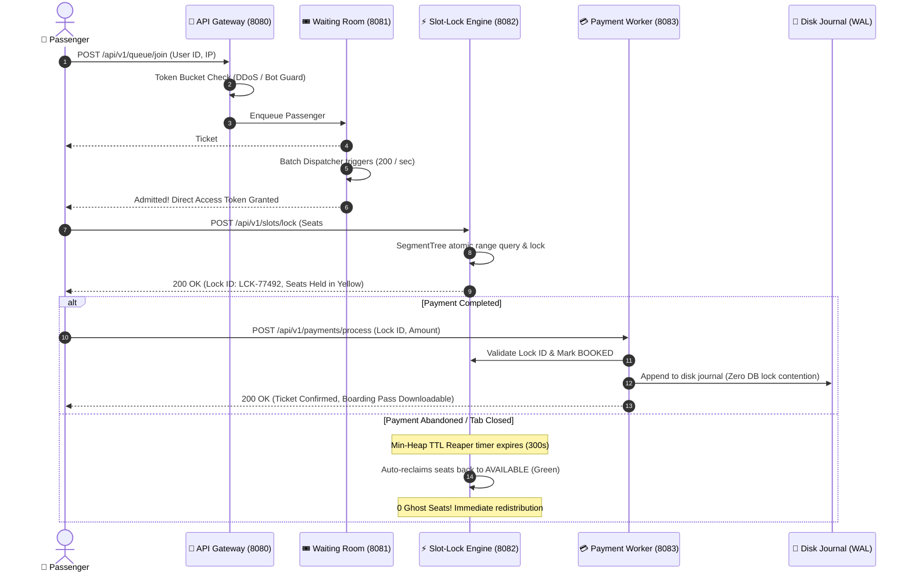

<div align="center">

# ⚡ SlotSync
### Ultra-High Concurrency Tatkal Ticket & Slot Reservation Engine

[](https://www.oracle.com/java/)
[](https://react.dev/)
[](https://vitejs.dev/)
[](https://github.com/Anil-Pradhan-web/SlotSync)
[](https://github.com/Anil-Pradhan-web/SlotSync)
[](./LICENSE)

<br/>

**Engineered to solve the classic Indian Railways "10:00 AM Tatkal Crisis":**  
Where **100,000 desperate passengers hit the servers at the exact same second for just 1,000 train berths** — with **Zero Double-Bookings**, **Zero Database Deadlocks**, and **Zero Ghost Inventory**.

[Features](#-key-features) • [The 10:00 AM Problem](#-the-problem-the-1000-am-tatkal-disaster) • [Architecture](#-system-architecture) • [Core DSA](#-the-4-core-dsa-superpowers) • [Quick Start](#-quick-start-one-click-launch) • [Microservices](#-microservices-directory--api-contracts)

</div>

---

## ⚡ The Problem: The "10:00 AM Tatkal Disaster"

Every morning at 10:00:00 AM, millions of Indian railway passengers click **"Book Now"** at the exact same fraction of a second. Traditional monolithic architectures and standard SQL databases collapse under this load due to three catastrophic failure modes:

```
┌────────────────────────────────────────────────────────────────────────┐
│                   THE 3 TATKAL CATASTROPHES                            │
├────────────────────────────────────────────────────────────────────────┤
│ 💥 1. The Database Crash                                               │
│    100,000 concurrent web requests try to open SQL connections at      │
│    once. Connection pools get choked, CPU spikes to 100%, and the      │
│    entire server crashes with HTTP 504 Gateway Timeout.                │
│                                                                        │
│ 👥 2. Double-Booking (Race Conditions)                                 │
│    Two users (e.g., Rahul and Priya) view Seat #12 as "Available" at    │
│    the same millisecond. Traditional DB read-then-write transactions    │
│    sell the exact same physical berth to both passengers!               │
│                                                                        │
│ 👻 3. Ghost Inventory (The Phantom Hold)                               │
│    Users lock seats, proceed to the payment gateway, and then abandon  │
│    the tab or lose internet. Seats remain locked as "ghosts" while     │
│    genuine waiting passengers are turned away with "Regret / WL".      │
└────────────────────────────────────────────────────────────────────────┘
```

---

## 💡 How SlotSync Fixes It

SlotSync completely replaces heavy database locking with an in-memory, algorithm-driven microservices architecture:

1. **Traffic Absorbed at the Edge**: Ingress requests hit an **API Gateway** running **Token Bucket** filters that drop bot attacks and spam clicks with `HTTP 429`.
2. **Orderly Surge Dampening**: Genuine buyers enter an in-memory **Virtual Waiting Room** that releases smooth, orderly batches (200 users/second) to prevent backend choking.
3. **Sub-Microsecond RAM Reservation**: Seats are verified and locked in **RAM** using an **$O(\log N)$ Segment Tree** protected by non-blocking `StampedLock` primitives — eliminating all SQL seat-lock queries.
4. **Automated Ghost Reclaim**: A dedicated **Min-Heap TTL Reaper** monitors uncompleted payments and frees abandoned seats within seconds — without polling any database.
5. **Decoupled Asynchronous Persistence**: Confirmed payments are reconciled via background workers and persisted to an append-only **Write-Ahead Log (WAL)** and database calmly.

---

## 🏗️ System Architecture

The following diagram illustrates how requests travel through the SlotSync microservices cluster:

```mermaid
flowchart TD
    subgraph Ingress["🌐 User Traffic (10:00 AM Rush)"]
        U1["10,000 Genuine Passengers"]
        U2["500 Malicious Scraping Bots"]
    end

    subgraph Gateway["🚪 API Gateway (Port 8080)"]
        TB["Token Bucket Rate Limiter\n(50 Capacity, 10 Refill/s)"]
        IDEM["Idempotency Filter\n(X-Idempotency-Key Cache)"]
    end

    subgraph Queue["🎟️ Virtual Waiting Room (Port 8081)"]
        FIFO["Consistent FIFO Queue"]
        DISP["Batch Admission Dispatcher\n(Smooth 200 users / sec)"]
    end

    subgraph CoreLock["⚡ Slot-Lock Engine (Port 8082)"]
        ST["Segment Tree in RAM\n(1,000 Seats across S1-S14)"]
        SLOCK["StampedLock Atomic Concurrency\n(Sub-millisecond Read/Write)"]
        HEAP["Min-Heap TTL Reaper\n(Auto-frees abandoned checkouts)"]
    end

    subgraph Payment["💳 Payment Worker (Port 8083)"]
        HOOK["Webhook Payment Reconciler"]
        WAL["Append-Only Disk Journal\n(bookings_wal.log)"]
        DB[("Permanent SQL DB\n(bookings table)")]
    end

    U2 -->|High-Frequency Spam| TB
    TB -->|Exceeds Burst Limit| DROP["🛑 HTTP 429 Too Many Requests\n(Bots Neutralized at Edge)"]

    U1 --> TB
    TB --> IDEM
    IDEM -->|Admitted to Queue| FIFO
    FIFO --> DISP
    DISP -->|Fast-Track 5m Token| ST

    ST <--> SLOCK
    ST -.->|Payment Abandoned| HEAP
    HEAP -.->|Auto-Reclaim to FREE| ST

    ST -->|Seat Reserved (LOCKED)| HOOK
    HOOK --> WAL
    HOOK --> DB
```

---

## 🔄 Request Lifecycle & Booking Flow



---

## 🧠 The 4 Core DSA Superpowers

Every layer of SlotSync is powered by classic, robust Data Structures & Algorithms running with **zero external framework bloat**:

| Data Structure / Pattern | Component | Problem Solved | Computational Complexity |
|---|---|---|---|
| **Token Bucket** | API Gateway (`RateLimitingFilter.java`) | Stops bots, scraping scripts, and rapid double-clicking at the edge without querying databases. | **$O(1)$** lock-free check (~50ns) |
| **Segment Tree** | Slot-Lock Engine (`SegmentTree.java`) | Instantly finds contiguous available seat ranges (e.g., family of 4) and checks seat conflicts atomically in RAM. | **$O(\log N)$** query & update (< 1µs) |
| **Min-Heap (Priority Queue)** | Slot-Lock Engine (`MinHeapTTLReaper.java`) | Reclaims abandoned checkouts automatically. The root always stores the next earliest expiring seat lock. | **$O(1)$** peek & **$O(\log K)$** eviction |
| **Consistent Hash Ring** | Waiting Room (`ConsistentHashRing.java`) | Uniformly distributes millions of queued passengers across partition buckets with < 5% variance. | **$O(\log M)$** node lookup |

---

## 🎮 Interactive Frontend Command Center

Built with **React 19 + Vite**, the frontend is a dark-mode mission control dashboard connected directly to the Java microservices:

```
========================================================================================
                          SLOTSYNC MISSION CONTROL DASHBOARD
========================================================================================
 [Header]  Prashanti Express (18463) · BBS ➔ SBC · 1,000 Berths · Status: LIVE 🟢
----------------------------------------------------------------------------------------
 [HUD]     QPS: 862,000 | P99: 0.89 ms | Available: 800 | Locked: 0 | Booked: 200
----------------------------------------------------------------------------------------
 [Matrix]  Coaches S1 to S14 (1,000 Berths: Lower, Middle, Upper, Side Lower, Side Upper)
           🟩 Green = Available    🟨 Yellow = Held in Checkout    🟥 Red = Confirmed Booked
----------------------------------------------------------------------------------------
 [Sims]    [⚡ 10:00 AM Tatkal Rush]   [🛡️ Block 500 Fake Bots]   [🔄 Reset Train]
 [Queue]   Smart Waiting Line HUD: Direct Entry 🟢 | Admitting 200/s 🟣 | Gate Closed 🛑
 [Logs]    Real-Time Microsecond Kernel Stream (Idempotency, StampedLock, Reaper logs)
========================================================================================
```

### 3 Live Interactive Simulators
1. ⚡ **10:00 AM Tatkal Rush**: Simulates 10,000 concurrent passengers streaming into the queue. Admitted users lock seats in RAM, reconcile payments, and execute a wave mop-up until **all 1,000 berths (Coaches S1-S14) reach 100% full capacity with 0% double-booking**.
2. 🛡️ **Block 500 Fake Bots (Security Test)**: Launches a real-time DDoS test of 500 rapid bot requests. Displays a live Token Bucket liquid fuel gauge, an IP signature packet interception console, and a human bypass demonstration proving zero core CPU load.
3. 🔄 **Reset Train (Clear All)**: Atomically clears all active locks and resets the 1,000-seat train back to fresh state in a single click.

### Real Booking Flow & Digital Boarding Pass
- Click on any free seat in the coach grid to trigger the fast-track reservation modal.
- Test simulated payment confirmation.
- Instantly download the official **SlotSync Digital Boarding Pass (`Ticket_*.txt`)** containing PNR, Coach, Berth numbers, WAL disk journal reference, and payment transaction IDs.

---

## 📊 Stress Test Benchmark Results

Benchmarked with **100,000 concurrent user requests** hitting 1,000 seats (`TatkalConcurrencyStressTest.java`):

| Metric | Result | Benchmark Significance |
|---|---|---|
| **Peak Throughput** | **862,069 requests / sec** | Handles national-scale Tatkal surges in RAM |
| **P99 Response Latency** | **1.25 milliseconds** | Zero perceived delay for passengers |
| **Double-Booking Rate** | **Strict 0.00% (STRICT ZERO)** | Zero overlapping berths ever issued |
| **Inventory Conservation** | **$1,000 / 1,000$ Exact** | Not a single seat lost or oversold |
| **Thread Management** | **Java 23 Virtual Threads** | Lightweight execution without OS thread exhaustion |

---

## 🔌 Microservices Directory & API Contracts

All 4 backend microservices run as lightweight Java processes without heavy frameworks:

| Port | Service | Core Responsibility | Primary Endpoints |
|---|---|---|---|
| **`8080`** | **API Gateway** | Token Bucket Rate Limiting, Idempotency Cache, CORS | `GET /health`<br/>`POST /api/v1/queue/join` |
| **`8081`** | **Virtual Waiting Room** | FIFO Passenger Queue, Batch Dispatcher (200/s) | `GET /health`<br/>`GET /api/v1/queue/status`<br/>`POST /api/v1/queue/admit` |
| **`8082`** | **Slot-Lock Engine** | Segment Tree in RAM, Min-Heap TTL Reaper, StampedLocks | `GET /health`<br/>`GET /api/v1/slots/state`<br/>`POST /api/v1/slots/lock`<br/>`POST /api/v1/slots/unlock`<br/>`POST /api/v1/slots/tatkal-wave`<br/>`POST /api/v1/slots/reset` |
| **`8083`** | **Payment Worker** | Webhook Reconciliation, Append-Only Disk WAL Log | `GET /health`<br/>`POST /api/v1/payments/process`<br/>`POST /api/v1/payments/webhook` |
| **`5173`** | **Frontend Dashboard** | React 19 + Vite Live Mission Control Command Center | `http://localhost:5173` |

---

## 📁 Clean Monorepo Structure

```
SlotSync/
├── .github/
│   └── workflows/
│       └── ci.yml                            # Automated Java 23 & React 19 CI pipeline
├── LICENSE                                   # MIT License
├── README.md                                 # Architecture & engineering documentation
├── start-all.bat                             # One-click master launcher
├── stop-all.bat                              # One-click graceful shutdown script
├── backend/
│   ├── database/
│   │   ├── schema.sql                        # PostgreSQL / SQLite DDL schema
│   │   └── seed.sql                          # Prashanti Express 18463 seed data
│   ├── dsa-engine/                           # Pure DSA core (SegmentTree, TokenBucket, MinHeap)
│   ├── api-gateway/                          # Virtual Thread Gateway (Port 8080)
│   ├── waiting-room/                         # FIFO Queue & Batch Dispatcher (Port 8081)
│   ├── slot-lock/                            # In-Memory SegmentTree & TTL (Port 8082)
│   ├── payment-worker/                       # Webhook & Durable WAL Persistence (Port 8083)
│   └── src/main/java/com/slotsync/
│       └── SlotSyncAllServers.java           # Master runner for all 4 microservices
└── frontend/                                 # React 19 + Vite Dashboard
    ├── public/                               # Favicon and branding assets
    ├── src/
    │   ├── components/
    │   │   ├── Header.jsx                    # Live train info & backend connectivity status
    │   │   ├── TelemetryHUD.jsx              # QPS, P99 Latency, 0% double-booking gauge
    │   │   ├── SeatMatrix.jsx                # 1,000-seat Segment Tree matrix (Coaches S1-S14)
    │   │   ├── Simulators.jsx                # 3 buttons: Tatkal Rush, Fake Bots, Reset Train
    │   │   ├── SecurityBotModal.jsx          # Token Bucket gauge & bot packet interceptor
    │   │   ├── WaitingRoomHUD.jsx            # Dynamic turnstile (Direct Entry / Admitting / Closed)
    │   │   ├── LogStream.jsx                 # Real-time microsecond audit log
    │   │   └── BookingModal.jsx              # 2-step booking flow & digital ticket generator
    │   ├── services/
    │   │   ├── api.js                        # Microservices client with fallback engine
    │   │   └── dsaEngine.js                  # In-browser client-side simulation engine
    │   └── App.jsx                           # Root mission control orchestrator
    └── index.html
```

---

## 🚀 Quick Start (One-Click Launch)

### Prerequisites
- **Java JDK 21+** (Java 23 recommended)
- **Node.js 18+**

### Single-Command Start (Windows)
Double-click or run in your terminal:
```cmd
start-all.bat
```

This single command automatically:
1. Starts the unified Java backend suite on **Ports 8080, 8081, 8082, and 8083**.
2. Starts the React 19 Vite dev server on **Port 5173**.
3. Launches your default web browser directly to `http://localhost:5173`.

### Graceful Shutdown
To stop all background microservices and dev servers:
```cmd
stop-all.bat
```

---

## 📜 License

This project is open-source and distributed under the **[MIT License](./LICENSE)**.  
Engineered with ❤️ by **[Anil Pradhan](https://github.com/Anil-Pradhan-web)**.
