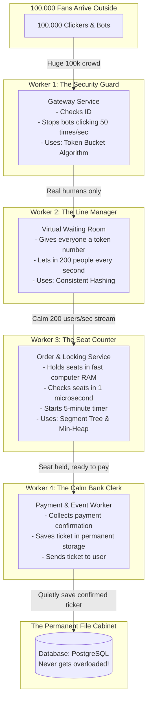

# SlotSync — High-Level Architecture (HLD)

## 1. The Big Picture: How SlotSync Works

Instead of one giant app that tries to do everything and crashes, SlotSync divides the work into **4 friendly workers (microservices)**. 

Think of this like a high-end concert hall with strict crowd control:



---

## 2. Meet the 4 Workers

### Worker 1: The Security Guard (`Gateway Service`)
* **Everyday Analogy**: A bouncer standing outside the stadium gates.
* **What it does**:
  * When 100,000 requests arrive, this guard checks who is a real human and who is an automated bot.
  * It uses the **Token Bucket** rule: If an IP address tries to click 30 times in one second, the guard immediately rejects it: *"Hey, calm down, click like a human!"* (HTTP 429 error).
* **Why it matters**: It stops bots from stealing tickets and protects the rest of the system from getting flooded.

### Worker 2: The Line Manager (`Virtual Waiting Room Service`)
* **Everyday Analogy**: The token counter at a bank or hospital.
* **What it does**:
  * Instead of letting 100,000 people fight at the ticket counter, this service puts everyone into an organized digital line.
  * It hands you a digital ticket: *"You are #320 in line. Your turn will come in 2 seconds."*
  * It sends exactly **200 people per second** into the booking room.
* **Why it matters**: The booking room only ever sees 200 people per second. It never feels crowded or slow.

### Worker 3: The Seat Counter (`Order & Locking Service`)
* **Everyday Analogy**: A super-fast attendant with a giant glowing seat map on a screen.
* **What it does**:
  * It holds the entire 1,000-seat map in computer memory (RAM), NOT on a slow hard drive.
  * When you say, *"Give me Seats 15, 16, 17, and 18 together"*, it uses a **Segment Tree** to check all 4 seats instantly (under 1 microsecond).
  * If free, it marks them as **"HELD"** for you.
  * It starts a **5-Minute Stopwatch (Min-Heap with TTL)**. If you do not pay in 5 minutes, it automatically frees your seats so someone else can buy them.
* **Why it matters**: Zero double-booking. Nobody can ever grab a seat that is already held. And no ghost seats get stuck forever.

### Worker 4: The Calm Bank Clerk (`Payment & Event Worker`)
* **Everyday Analogy**: The cashier at the exit counter.
* **What it does**:
  * When you finish paying on the payment screen (via UPI, Card, or NetBanking), this worker catches the bank's confirmation.
  * It turns the temporary "HELD" seat into a permanent **"CONFIRMED"** booking.
  * It writes the final booking into the SQL database file cabinet, generates your PDF ticket, and sends you an email.
* **Why it matters**: The database only writes confirmed sales. It never gets overloaded with lookups or abandoned attempts.

---

## 3. What Happens When You Book (The Clean Flow)

```
Your Phone                 Guard (Gateway)      Line Manager         Seat Counter         Bank Clerk
    │                            │                    │                    │                   │
    ├─ 1. Click "Join Sale" ────>│                    │                    │                   │
    │  (Are you human?)          │                    │                    │                   │
    │                            ├─ 2. Place in line ─>│                    │                   │
    │<─ 3. "You are #45 in line" ─────────────────────┤                    │                   │
    │                            │                    │                    │                   │
    │<─ 4. "It's your turn!" ─────────────────────────┤ (Admits 200/sec)   │                   │
    │                                                                      │                   │
    ├─ 5. "Lock Seats 20 to 22" ──────────────────────────────────────────>│                   │
    │                                                  [Checks RAM in 1µs] │                   │
    │                                                  [Starts 5-min timer]│                   │
    │<─ 6. "Seats Locked! You have 5 minutes to pay" ──────────────────────┤                   │
    │                                                                                          │
    ├─ 7. Pay via UPI / Card ─────────────────────────────────────────────────────────────────>│
    │                                                                     [Saves to DB]        │
    │<─ 8. "Booking Confirmed! Here is your Ticket" ───────────────────────────────────────────┤
```

---

## 4. Why This System Never Crashes

1. **Slow DB is never on the front lines**: The database sits comfortably in the back. Only paid tickets ever touch the database.
2. **Smooth, predictable speed**: Even if 1 million people click, the line manager strictly lets in 200 users per second. The servers never see a spike they cannot handle.
3. **Automatic Clean-up**: If a user abandons their cart, the 5-minute timer quietly frees the seat without anyone having to restart or reboot anything.
