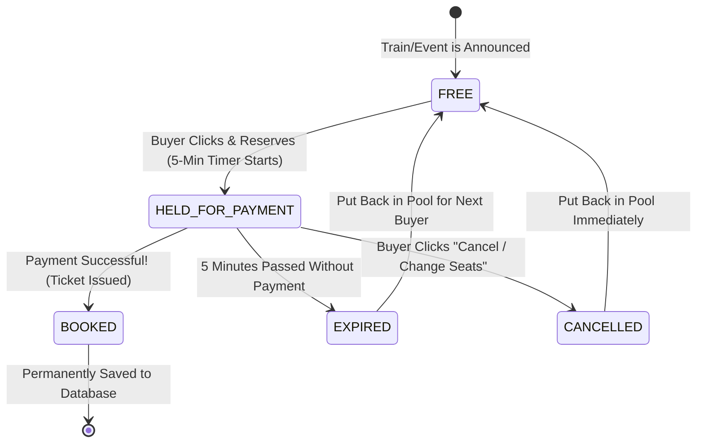

# SlotSync — Seat Life Cycle & Tricky Edge Cases

## 1. The Life of a Seat (State Machine)

Every seat in SlotSync goes through a simple, clear life cycle. A seat can never be in two states at the same time:

---

## 2. The 4 States of a Seat Explained

| State | What It Means | Can Someone Else Take It? |
|---|---|---|
| **`FREE`** | The seat is available for anyone to choose. | **YES** — First person to click gets it. |
| **`HELD_FOR_PAYMENT`** | A buyer selected this seat and is currently on the payment page. A 5-minute timer is ticking. | **NO** — Locked exclusively for this buyer. |
| **`BOOKED`** | The payment succeeded! The ticket has been created and saved in the database. | **NO** — Permanently owned by the buyer. |
| **`EXPIRED`** | The 5-minute timer ran out because the buyer abandoned checkout. | The seat is immediately flipped back to **`FREE`**. |

---

## 3. How SlotSync Handles Tricky Real-Life Situations

### Situation 1: The "Impatient User" Who Clicks 10 Times
* **The Problem**: A user's internet is slow, so they aggressively click the "Pay & Book" button 10 times in 2 seconds.
* **The Risk**: Does the system charge them 10 times and give them 10 duplicate seats?
* **SlotSync Solution**: 
  * Every checkout button has a hidden unique sticker called an **Idempotency Key** (like an order token: `ord_98765`).
  * When the 1st click arrives, the system registers `ord_98765`.
  * When clicks 2 through 10 arrive, the system says: *"Hey, I am already processing order ord_98765. Chill, you won't be charged twice!"*

### Situation 2: Two Users Click the Exact Same Seat at the Same Millisecond
* **The Problem**: Rahul and Priya both hit "Reserve Seat #45" at 10:00:01.000 AM.
* **The Risk**: Both think they got the seat (Double-booking disaster).
* **SlotSync Solution**:
  * In the computer's memory, we use an **Atomic Lock** (like a single physical pen).
  * Only one person can hold the pen at a time.
  * Rahul's click grabs the pen first by a microsecond and marks Seat #45 as `HELD_FOR_PAYMENT`.
  * When Priya's click arrives a microsecond later, the pen sees Seat #45 is already taken. Priya instantly sees a friendly message: *"Oops! Someone just grabbed Seat #45. Please pick another seat!"*
  * **Result: Strict 0% double-booking.**

### Situation 3: The Abandoned Tab (Ghost Inventory)
* **The Problem**: Amit holds Seat #12, gets to the payment page, and closes his laptop or walks away.
* **The Risk**: Other genuine buyers are told the train is full, while Seat #12 sits empty.
* **SlotSync Solution**:
  * The **Min-Heap Alarm Clock** is watching Seat #12.
  * Exactly at 5 minutes (300 seconds), the alarm rings.
  * It sees that no payment confirmation arrived from the bank.
  * It quietly erases the lock and makes Seat #12 `FREE` again for the next user in the waiting line.

### Situation 4: What if a Server Restarts Unexpectedly?
* **The Problem**: While 50 seats are temporarily held, the server computer restarts.
* **The Risk**: Do we lose track of who was paying?
* **SlotSync Solution**:
  * Every time a seat is held, a quick backup note is saved in **Redis** (an ultra-fast distributed memory cache).
  * If the server restarts, it reads the Redis backup in less than 1 second and restores all active holds.
