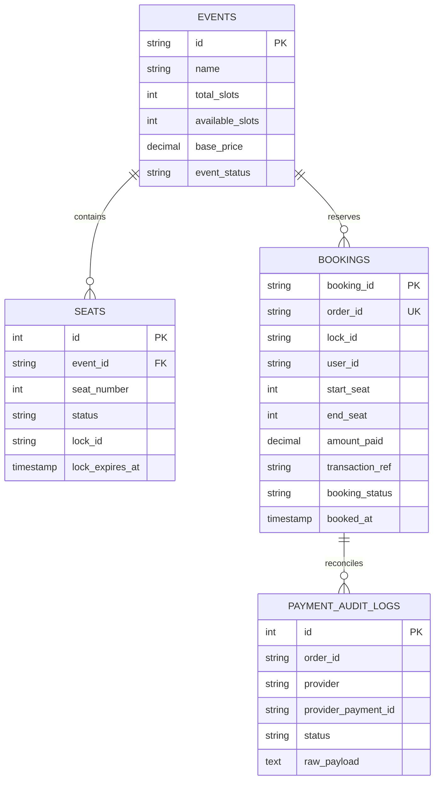

# SlotSync: Fullstack Architecture & Database Specification

## 1. Executive Overview

SlotSync is an ultra-high concurrency ticket reservation engine built to eliminate the classic **10:00 AM Tatkal / Flash-Sale Concurrency Crash**. When 100,000 users hit 1,000 seats simultaneously, standard relational databases collapse under lock contention.

To solve this, SlotSync decouples the transaction path into a **3-tier architecture**:
1. **In-Memory Volatile Fast-Path (`dsa-engine` in RAM)**: Segment Tree ($O(\log N)$ range checks & atomic locks) + Token Bucket (HTTP 429 rate limiting) + Min-Heap TTL auto-reaper (5-minute hold without SQL polling).
2. **Durable Cold-Path (`backend/database/` + `payment-worker`)**: Permanent SQL schema (`events`, `seats`, `bookings`, `payment_audit_logs`) and disk WAL log (`bookings_wal.log`) storing confirmed financial tickets.
3. **Live Telemetry & Command Center (`frontend/`)**: Real-time interactive dashboard visualizing 1,000 seats, HUD throughput metrics, ghost inventory countdowns, and live attack simulations.

---

## 2. Directory Structure

```
SlotSync/
├── backend/
│   ├── pom.xml                               # Parent Maven Configuration
│   ├── database/
│   │   ├── schema.sql                        # DDL for PostgreSQL/SQLite
│   │   ├── seed.sql                          # Tatkal Express 12301 seed data
│   │   └── bookings_wal.log                  # Append-only durable disk journal
│   ├── dsa-engine/                           # Core DSA Algorithms (0 dependencies)
│   │   ├── src/main/java/com/slotsync/dsa/
│   │   │   ├── ratelimiter/TokenBucket.java
│   │   │   ├── segmenttree/SegmentTree.java
│   │   │   ├── ttl/MinHeapTTLReaper.java
│   │   │   └── hashring/ConsistentHashRing.java
│   ├── api-gateway/                          # Virtual Thread Gateway (Port 8080)
│   ├── waiting-room/                         # FIFO Queue & Batch Admission (Port 8081)
│   ├── slot-lock/                            # High-Speed RAM Seat Engine (Port 8082)
│   └── payment-worker/                       # Webhook & Durable Persistence (Port 8083)
├── frontend/
│   ├── index.html                            # Mission Control HUD Layout
│   ├── css/
│   │   ├── style.css                         # Dark obsidian tokens & glassmorphism
│   │   ├── seat-grid.css                     # 1,000-seat Segment Tree matrix styling
│   │   └── components.css                    # Modals, HUD cards, badges, live stream
│   └── js/
│       ├── dsa-sim.js                        # Exact client-side DSA replica (fallback)
│       ├── api.js                            # Dual-mode backend fetcher
│       ├── seat-grid.js                      # Coach & seat matrix renderer
│       └── app.js                            # State manager, simulators & booking flow
└── planning/                                 # Engineering Specifications & ADRs
    ├── 01-System-Architecture.md
    ├── 02-PRD-Functional-Non-Functional.md
    ├── 03-DSA-Deep-Dive.md
    ├── 04-Microservices-and-APIs.md
    ├── 05-Implementation-Roadmap.md
    └── 06-Fullstack-Architecture-and-Database.md
```

---

## 3. Database Schema Design (`backend/database/schema.sql`)

### 3.1 Entity Relationship Model


### 3.2 In-Memory vs. Database Division of Labor
| Feature | RAM Layer (`dsa-engine`) | SQL Database (`backend/database`) |
| :--- | :--- | :--- |
| **Contiguous Range Check** | $O(\log N)$ via SegmentTree | $O(N)$ full table scan (Avoided!) |
| **Race-Condition Locking** | Atomic `StampedLock` in microsecond | Row-level `SELECT FOR UPDATE` (Eliminated) |
| **5-Minute Hold Timer** | MinHeap TTL auto-reaper | Periodic polling worker (Eliminated) |
| **Confirmed Ticket Ledger** | Read-through cache | Durable ACID `bookings` table + WAL |
| **Financial Audit Trail** | Not stored | Immutable `payment_audit_logs` |

---

## 4. Frontend Command Center Experience

The frontend is styled as an **Obsidian Mission Control** with:
1. **Live Concurrency Telemetry HUD**: Live QPS, P99 Latency (sub-millisecond), Double-Booking Anomaly Rate (`0.00% STRICT ZERO`), and Ghost Inventory auto-reclaimed count.
2. **1,000-Seat Matrix**: Arranged into 14 train coaches (S1 to S14) with real-time status transitions (Available Green, 5-Min Hold Glowing Amber, Booked Red).
3. **Interactive Booking Flow**: Select contiguous seats, experience simulated queue admission, hold countdown, and simulated UPI payment with instant digital ticket issuance.
4. **Interactive Attack Simulators**:
   - **Tatkal Rush Simulator**: Simulates 10,000 concurrent users competing for seats.
   - **Bot Defense Simulator**: Simulates 500 malicious scraper bot requests hitting the Token Bucket rate limiter (HTTP 429).
   - **Ghost Inventory Expiration**: Demonstrates how seats abandoned by users are automatically reclaimed after 5 minutes without SQL polling.
